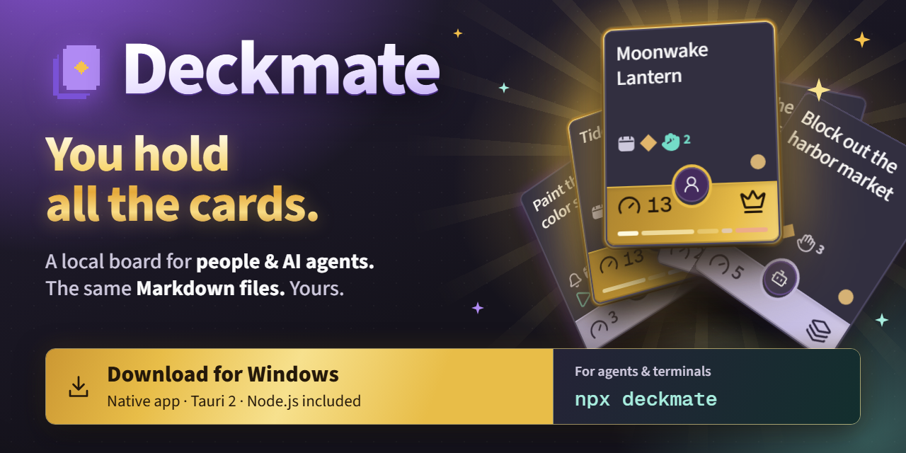
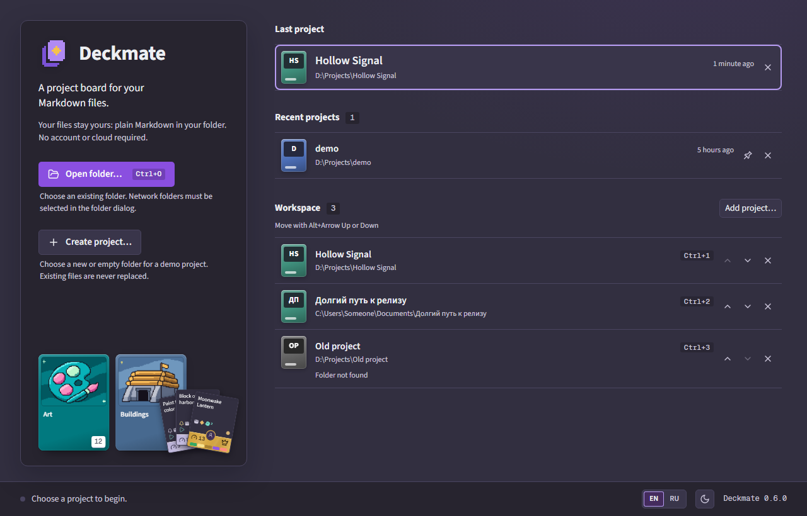
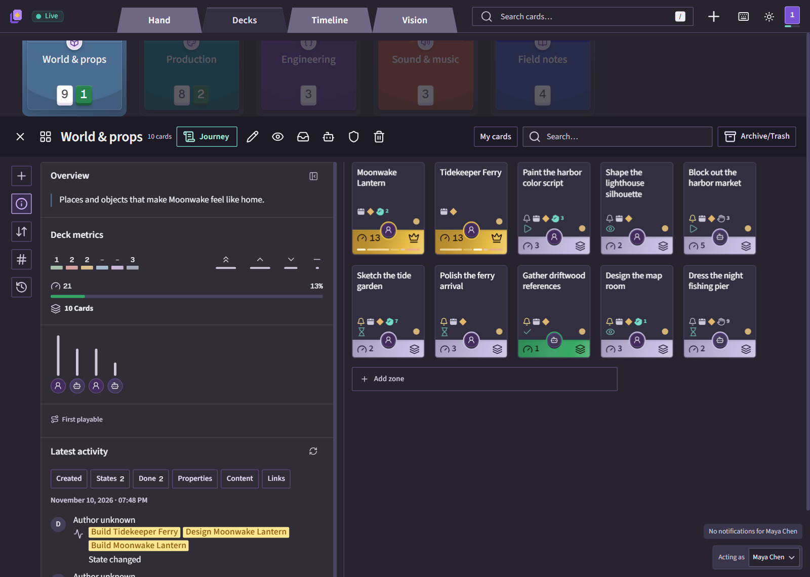
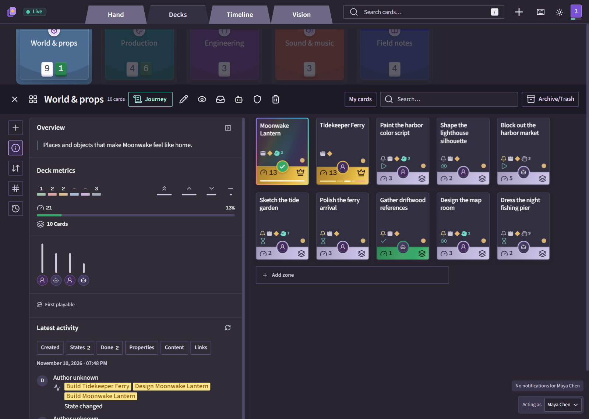
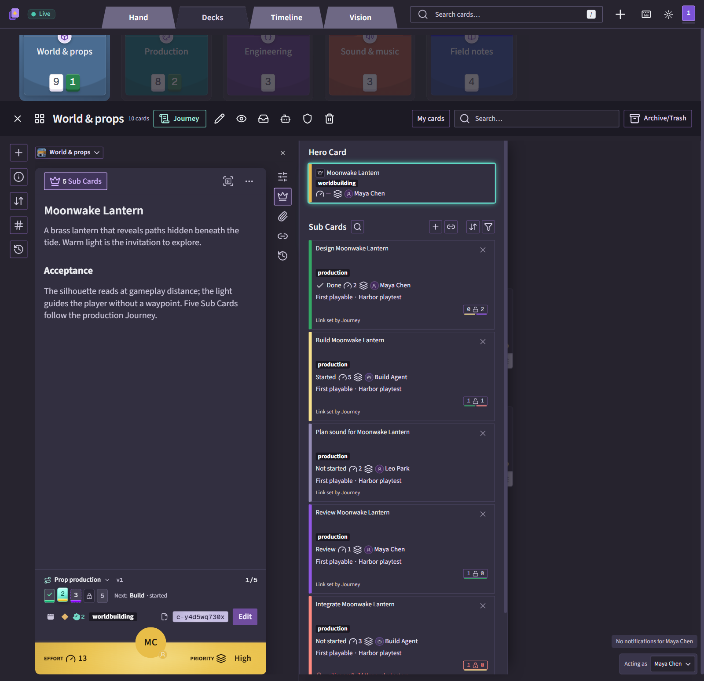
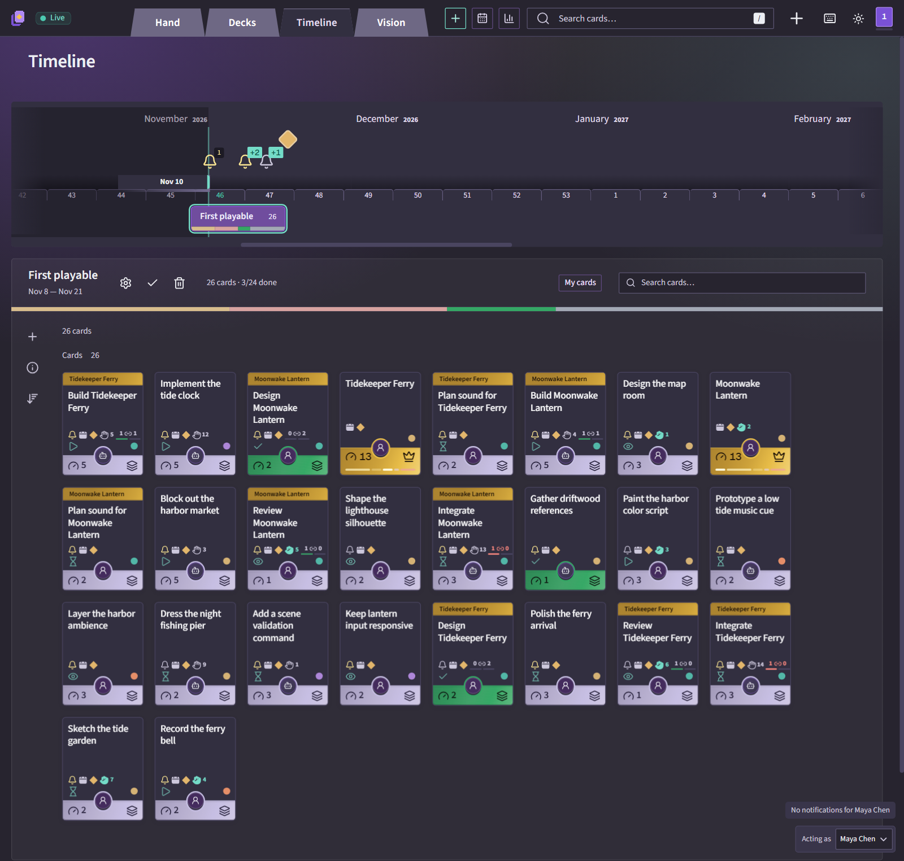
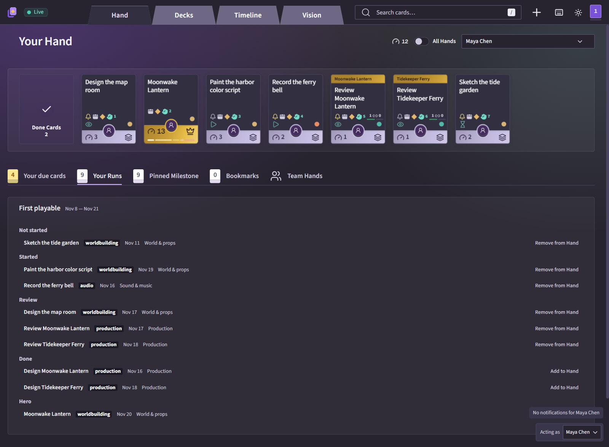
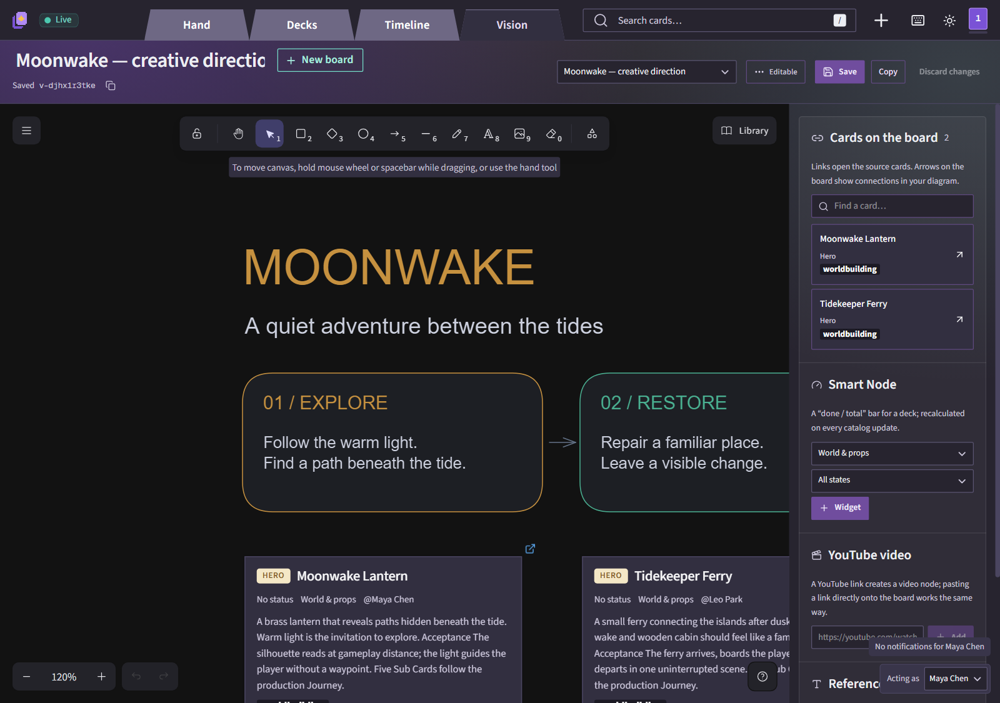

<p align="center">
  <a id="deckmate" href="https://github.com/pierkulakov/deckmate/releases/latest">
    
  </a>
</p>

<h3 align="center" id="you-hold-all-the-cards">You hold all the cards.</h3>

<p align="center">
  <b>A local project board for people and AI agents.</b><br />
  Your cards are Markdown files in your repository. Work in the app; your agents work on the same files.
</p>

<p align="center">
  <a href="https://github.com/pierkulakov/deckmate/releases/latest"><b>Download for Windows →</b></a>
  &nbsp; · &nbsp;
  <a href="#cli"><code>npx deckmate</code></a> for agents &amp; terminals
</p>

<p align="center">
  Open a project folder, create a new one, or pick up a recent project.<br />
  <sub>Lightweight native app · Tauri 2 · Node.js included · No terminal needed</sub>
</p>

<p align="center">
  <a href="https://github.com/pierkulakov/deckmate/releases/latest"></a>
  <a href="https://github.com/pierkulakov/deckmate/actions/workflows/ci.yml"></a>
  <a href="https://github.com/pierkulakov/deckmate/blob/main/LICENSE"></a>
</p>

<p align="center"><sub>Early release · macOS planned · Project file format (schema 1) may change before 1.0.</sub></p>

<p align="center">
  <a href="#quick-start">Quick start</a> · <a href="#use-it-with-your-project">Your project</a> · <a href="#how-it-works">Concepts</a> · <a href="#decks-inbox-and-sub-cards">Decks and Inbox</a> · <a href="#working-with-ai-agents">Agents</a> · <a href="#faq">FAQ</a>
</p>

<p align="center"><b>English</b> · <a href="README.ru.md">Русский</a></p>

## Quick start

### Desktop

Deckmate Desktop is a lightweight Tauri 2 app for Windows 10 and 11 (x64); macOS support is planned. Download the installer (`Deckmate.Setup.<version>.exe`) or portable zip (`Deckmate-<version>-win-x64.zip`) from the [latest release](https://github.com/pierkulakov/deckmate/releases/latest). The installer is about 32 MB; the installed app is about 131 MB. The builds are not Windows code-signed, so SmartScreen may warn about an unknown publisher: choose **More info → Run anyway**.

Run the installer and launch Deckmate from its icon, or unzip the portable build and start `Deckmate.exe`. The app includes Node.js 26 for its local server; no terminal is needed. Open a project folder or choose **Create project…** to fill an empty folder with a sample project.

The interface uses [Microsoft Edge WebView2 Runtime](https://developer.microsoft.com/microsoft-edge/webview2/), included with Windows 11 but not necessarily Windows 10. The portable build requires it to be installed already; the installer installs it if missing, which needs internet access. The zip contains `Deckmate.exe`, `node.exe`, `deckmate/` and `THIRD-PARTY-NOTICES.txt`.

When upgrading from Electron (0.5.0 and earlier), the installer removes the old app and leaves `%APPDATA%\Deckmate` and project folders untouched. Recent projects, language, zoom and window position carry over.

### Desktop updates

Desktop checks for updates automatically by default; use **Help → Check for updates…** to check manually or turn automatic checks off in the same menu. The installed app downloads updates and verifies their updater signature and version, then offers to restart and install them. This signature is separate from Windows code signing. You can defer or skip a version.

The portable build only notifies you and offers to open the download page; download and replace it yourself. After an in-app update, **What's new** opens with the changes since the previous version. You can also open it from **Help → What's new**.

### CLI

The CLI works independently of Desktop, for agents and anyone who prefers a terminal. Install [Node.js](https://nodejs.org) 26 or newer (Deckmate is developed and tested on Node 26, the current release line; older versions are not tested), then create the sample project and open it:

```sh
npx deckmate init deckmate-demo
npx deckmate --data deckmate-demo
```

To run from source instead, follow [CONTRIBUTING.md](https://github.com/pierkulakov/deckmate/blob/main/CONTRIBUTING.md): `npm ci && npm run build`, then `node bin/deckmate.mjs init deckmate-demo` creates the demo and `node bin/deckmate.mjs --data deckmate-demo` opens it.

The board opens at `http://127.0.0.1:4317/`. The sample is a small fictional game studio: five decks, two Heroes with Sub Cards, people and agents, a Journey, a Run and a Vision board. The browser interface defaults to English; switch to Russian in the app menu. Stop the server with `Ctrl+C`.

## Start screen



Without a project, choose **Open folder…** to select a folder, or **Create project…** to put the sample in an empty or new folder. Recent projects show their last-opened time and can be removed from the list; language (EN/RU) and theme controls are also available. Desktop initially follows the system locale for English or Russian.

Pin up to 30 projects to **Workspace** from the start screen or the board's project menu. Reorder or remove them without deleting their folders; switch with a click or `Ctrl+1`–`Ctrl+9` for the first nine. Projects are not pinned merely by opening them.

The last local project opens on the next launch if its folder is available; network folders are not reopened automatically. Use **File → Switch project…** (`Ctrl+Shift+P`) to return to the start screen, or `Ctrl+O` to open another folder. Desktop runs the local server on `127.0.0.1`, reusing its saved port when available and choosing a free port otherwise. Project data remains in the project folder.

Settings — workspace, recent projects, language, updates, zoom and window position — live in `%APPDATA%\Deckmate\desktop.json`; the server log is `server.log` next to it, and the disposable index is in `%APPDATA%\Deckmate\index`.

## Use it with your project

**An existing folder.** In Desktop, open the folder from the start screen. With the CLI, run Deckmate from the folder you want to manage; Markdown files you already have stay as they are, and new cards go into `cards/`:

```sh
cd my-project
npx deckmate
```

**A new project.** To start with an empty project in Desktop, choose **Open folder…** and select an empty folder. With the CLI, create an empty folder and open it: `mkdir my-game`, then `npx deckmate --data my-game`. On the Decks tab choose **Start from template** (or click the logo in the top-left corner → **Start from template…**). Starters come for games and for software, on the **Games** and **Software** shelves: ten game genres — Action, Adventure, Platformer, Puzzle, Roguelike, RPG, Simulation, Sports, Strategy and Survival — plus software starters such as pet projects, web apps and libraries. A starter creates decks and Journeys for its kind of project, optionally with example cards.

Built-in project and Journey templates show Russian titles and descriptions in the Russian interface. Importing a Journey into a Russian-format project also gives it a Russian name.

Edits are saved straight into the project folder. Commit with git to keep a history; Deckmate never commits for you. With the CLI, add `--read-only` to look without changing anything.

| Option | What it does |
|---|---|
| `--data <folder>` | Project folder; defaults to `DECKMATE_DATA`, then the current folder. |
| `--port <number>` | Port; defaults to `DECKMATE_PORT`, then 4317. |
| `--read-only` | Disable writes to project files. |
| `--no-open` | Do not open the browser. |

These CLI settings can also live in `.env.local` in the folder you start from — see [.env.example](.env.example).

## How it works

| Concept | Meaning |
|---|---|
| **Deck** | A typed collection of cards — tasks, documents or assets — grouped into spaces. |
| **Card** | A native card is a Markdown file in `cards/`; existing project documents can also appear as cards. A **Task** has a state, owner, effort and priority; a **Doc** holds rules and reference text. |
| **Hero** | A feature card. Its **Sub Cards** are the tasks that build it, and its progress comes from them. |
| **Hand** | A teammate's queue: seven focus slots, an ordered reserve and a pile of accepted cards with weekly counts. |
| **Run** and **Milestone** | A dated iteration and a dated goal on the Timeline. Unfinished cards move to the next Run. |
| **Journey** | A repeatable recipe of steps, such as concept → model → review. Applying it creates Sub Cards, each with its own instructions for a person or an agent. |
| **Track** | A thread that links cards across decks, such as a release or a feature area. |
| **Vision** | An Excalidraw canvas with live links to cards. |

Start on **Decks**: document and card counts sit under the project name; source warnings open from the same line. Jump from the project pulse to work in progress, reviews, the current Run or cards that need a deck. Compact covers show card counts and task progress. Arrange decks with the mouse or keyboard. Reorder spaces with the arrows in their headers or the Position field in space settings. Search deck names to find a deck even inside a collapsed space.

Open a deck to work with its cards, description, progress and activity:



A Hero tile shows Sub Card progress as a quiet line, with each step sized by its effort. When it has eligible Task Sub Cards and all of them are accepted, the Hero gains holographic foil, an iridescent rim and a done medallion; `wont-do` tasks are excluded. The foil follows the pointer; with reduced motion or touch it stays still. Doc Sub Cards appear in the Hero's family too, but only Task Sub Cards count towards its progress; the Sub Cards panel flags those without a deck. Drop a Task that has no Sub Cards into an Asset deck and Deckmate offers to make it a Hero. A native Hero without eligible Task Sub Cards can be marked done by hand from its Sub Cards bar. Doc Cards read as pages: a copper band with the word count, and the start of the text on the tile.



Press `?` in the app for all keyboard shortcuts: `N` creates a card, `/` searches, `Shift+1`–`Shift+4` switch between Hand, Decks, Timeline and Vision, and hovering a card with `O`, `E`, `P` or `,` changes its owner, effort, priority or Run.

On an open card, use its properties for quick settings and click a tag to open project tags. A Hero shows its Journey as mini-cards; the Journey name opens a menu of steps and assignees. Open a step to see its Sub Card, then press `Esc` to return to the Hero. In the text editor, use the paperclip to insert an attachment, or copy its Markdown link from the attachments panel. Deleting an attachment used in the text offers to remove its links too. An image whose file is missing shows a “file not found” chip. Card covers are not used.

<table>
<tr>
<td width="50%" valign="top">
<a href="https://raw.githubusercontent.com/pierkulakov/deckmate/main/docs/screenshots/card.png"></a>
<strong>Cards and Journeys</strong><br />Markdown with owners, effort, dependencies and a Journey's progress.
</td>
<td width="50%" valign="top">
<a href="https://raw.githubusercontent.com/pierkulakov/deckmate/main/docs/screenshots/timeline.png"></a>
<strong>Runs and Milestones</strong><br />Dates on a timeline; unfinished cards carry into the next Run.
</td>
</tr>
<tr>
<td width="50%" valign="top">
<a href="https://raw.githubusercontent.com/pierkulakov/deckmate/main/docs/screenshots/hand.png"></a>
<strong>A Hand for each teammate</strong><br />Focus slots, reserve and done pile, for people and agents alike.
</td>
<td width="50%" valign="top">
<a href="https://raw.githubusercontent.com/pierkulakov/deckmate/main/docs/screenshots/vision.png"></a>
<strong>Vision</strong><br />Sketch on an Excalidraw canvas with live card and progress nodes.
</td>
</tr>
</table>

## Decks, Inbox and Sub Cards

### Deck types

Each deck accepts certain card types:

| Deck type | Cards it accepts |
|---|---|
| Asset | Hero |
| Task | Task |
| Knowledge | Doc |
| Mixed | Hero, Task and Doc |

Use Asset decks for GDD features (Heroes), Task decks for work, and Knowledge decks for reference. Mixed decks can combine them. When moving cards, incompatible decks appear dimmed in the transfer dock.

### Sub Cards

A Sub Card is a Task or Doc linked to a Hero. It usually belongs in a department's working deck, such as Art or Coding, rather than the Hero's Asset deck, so the people doing the work can find it there. The link to the Hero remains across decks.

Open the Hero, choose **New Sub Card**, select a destination under **Create Card in**, enter a title and optional description, and choose **Create**. A Knowledge deck creates a Doc; the other choices create a Task. The initial choice is the current suitable deck if available, then a recently used deck, Inbox, a deck that accepts Tasks, or no deck. A Hero-only Asset deck is not selected.

The automatic option says **Auto: Inbox →** followed by the deck name when Inbox is available, or **No deck (Unassigned)** otherwise. If no suitable deck is available, the Sub Card is still created without a deck.

### Inbox

Inbox is an ordinary deck designated as the receiver, not a separate built-in deck. Open an existing deck's settings and check **Inbox deck**; its cover shows a tray icon. Only Task and Mixed decks can be assigned; the checkbox is disabled for Asset and Knowledge. Changing an Inbox deck to a type that cannot accept Tasks removes its Inbox assignment.

When no deck is selected for a new card, it goes to Inbox only if Inbox accepts its type; otherwise it is created without a deck. The new-card form shows **→ Inbox:** and the deck name, or **→ No deck**. Without an assigned Inbox, cards created without a selected deck are also left without one: find them on the Decks home screen under **Without a deck** and **Sort into decks**.

Starter templates assign Inbox to their first Task deck if none is set; in the demo, Inbox is Production.

### Only an Asset deck?

If you have only an Asset deck, a new Sub Card is created without a deck. For a useful destination, create a Task deck, or designate an existing Task or Mixed deck as Inbox; then move the card into a suitable deck.

## Working with AI agents

An agent reads and edits the same files the board shows. A card looks like this:

```markdown
---
deckmate: card
schema: 1
id: 3c83da5b-a6b4-4b29-9b20-0aace7b274ab
kind: task
title: Tune lantern glow
state: not-started
owner: null
deckId: null
trackIds: []
parentId: null
effort: 2
priority: medium
---
Make the path readable without revealing the whole forest.

- [ ] Check the light at gameplay distance.
- [ ] Ask a teammate to review the result.
```

States are `not-started`, `discussing`, `in-iteration`, `started`, `review` and `done`; `wont-do` marks work decided against. Decks, members and tracks live in `tasks/deckmate.md`; Runs and Milestones in `tasks/deckmate-runs.md` and `tasks/deckmate-milestones.md`; Journeys in `tasks/journeys/`; Vision boards in `boards/`. The file format also has Russian words (`план`, `в работе`, `принято`…): a project writes in the language recorded in its manifest, and Deckmate reads both.

Add people and agents in the logo menu → **Members…**; `<member>` below is a name or ID from there. The `project` command gives an agent compact JSON or Markdown without a running server, so it reads only what the task needs (add `--json` to `brief` for JSON):

```sh
npx deckmate project next <member>        # the next card in a member's Hand
npx deckmate project brief <card-ref>     # the card, its rules and what to read next
npx deckmate project report <card-ref> --file report.md --member <member> --state review
```

Assigning an owner never starts a model. The example submits work for review; a reviewer can then accept it. If a deck has Guardians, only a Guardian can accept its cards.

Deckmate also ships an agent skill in the open Agent Skills format. Once the project has its first deck or member, `npx deckmate skills install` copies it into the project for Claude Code and other agents; then `/deckmate work <card>`, `/deckmate plan`, `/deckmate review <card>` and other scenarios guide the model through the board. See [docs/skills.md](docs/skills.md), the [data contract](docs/catalog.md) and the [local API](docs/api.md).

## FAQ

**Where is my data?** In your project folder: Markdown cards and instructions, the catalog manifest and `.excalidraw` boards. The SQLite index lives in a cache folder and is rebuilt from the files. Desktop keeps its settings and the index separately in `%APPDATA%\Deckmate\` (`desktop.json` and `index`).

**Do I need the internet?** To download Deckmate, install WebView2 when needed, check for Desktop updates, download Excalidraw's handwritten fonts and load external embeds in Vision. The board itself runs locally on `127.0.0.1`; agents can read the files with the server stopped.

**Do I need Python?** Only projects with their own `Tools/board.py` need Python.

**Can a team use it?** Yes, through git: everyone runs Deckmate on their own checkout, and edits merge like any other file. Conflicting saves are rejected rather than overwritten.

**What about Docker?** Clone the repository and build the image in its folder with `docker build -t deckmate .`. Then view a project from its folder: `docker run --rm -p 127.0.0.1:4318:4318 -e DECKMATE_READ_ONLY=1 -v "$PWD:/data:ro" deckmate`. Or run the published image directly: `docker run --rm -p 127.0.0.1:4318:4318 -e DECKMATE_READ_ONLY=1 -v "$PWD:/data:ro" ghcr.io/pierkulakov/deckmate:latest` (releases publish `:<version>` and `:latest`). In PowerShell write `${PWD}` instead of `$PWD`. Keep the host port equal to the container port (or `DECKMATE_PORT`): the server accepts only `Host` values `127.0.0.1:<port>`, `localhost:<port>` and `[::1]:<port>`, so a different mapping returns 403 for every request. Open `http://127.0.0.1:4318/`. The image is Node 26 on bookworm-slim without Python or Git, so projects using the legacy `Tools/board.py` renderer cannot be opened for editing in the container and Git-backed card history is unavailable there; native Deckmate projects and the documented read-only example work.

**How is this different from a cloud board?** Your board is files in your repository: no account, no server to host, and agents read it without an API.

## Contributing

Bug reports, ideas and pull requests are welcome; [SUPPORT.md](https://github.com/pierkulakov/deckmate/blob/main/SUPPORT.md) explains where to ask questions and report bugs. [CONTRIBUTING.md](https://github.com/pierkulakov/deckmate/blob/main/CONTRIBUTING.md) covers running from source, tests and project rules; [AGENTS.md](https://github.com/pierkulakov/deckmate/blob/main/AGENTS.md) is the short guide for coding agents. Please follow the [Code of Conduct](https://github.com/pierkulakov/deckmate/blob/main/CODE_OF_CONDUCT.md) and report vulnerabilities through [SECURITY.md](SECURITY.md), not public issues. Changes are listed in the [changelog](CHANGELOG.md).

For source development, `npm run dev` starts the watched server and Vite with hot reload at `http://127.0.0.1:4318/`; pass server options after `--`, for example `npm run dev -- --data deckmate-demo`.

## License

[AGPL-3.0-only](https://github.com/pierkulakov/deckmate/blob/main/LICENSE) © 2026 pierkulakov and Deckmate contributors. You may use, change and share Deckmate; if you offer a modified version as a network service, you must publish its source. Contributions are accepted under the [Contributor License Agreement](https://github.com/pierkulakov/deckmate/blob/main/CLA.md).

## Acknowledgements

Vision uses [Excalidraw](https://excalidraw.com); the interface uses [shadcn/ui](https://ui.shadcn.com) and Tailwind CSS. See [asset sources and font licenses](assets/README.md) for the logo, AI-generated deck illustrations, demo screenshots and bundled fonts.
