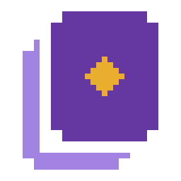
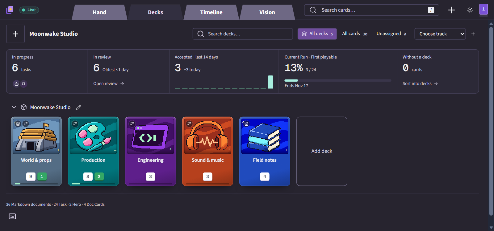
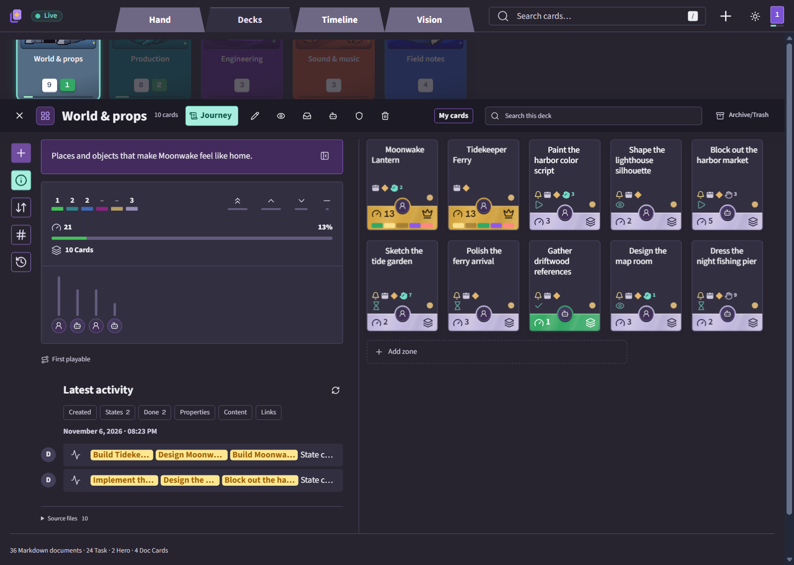
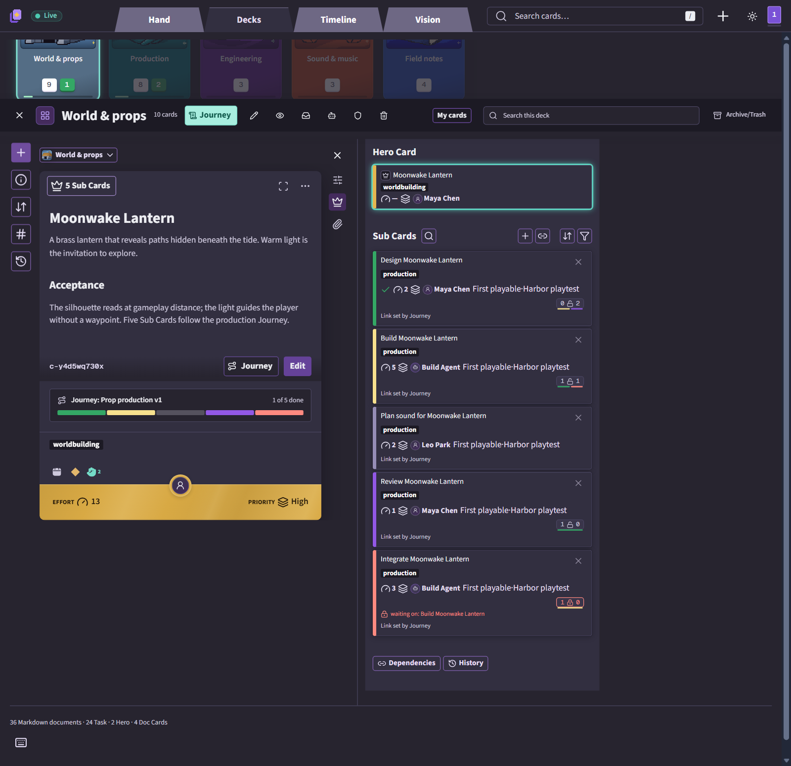
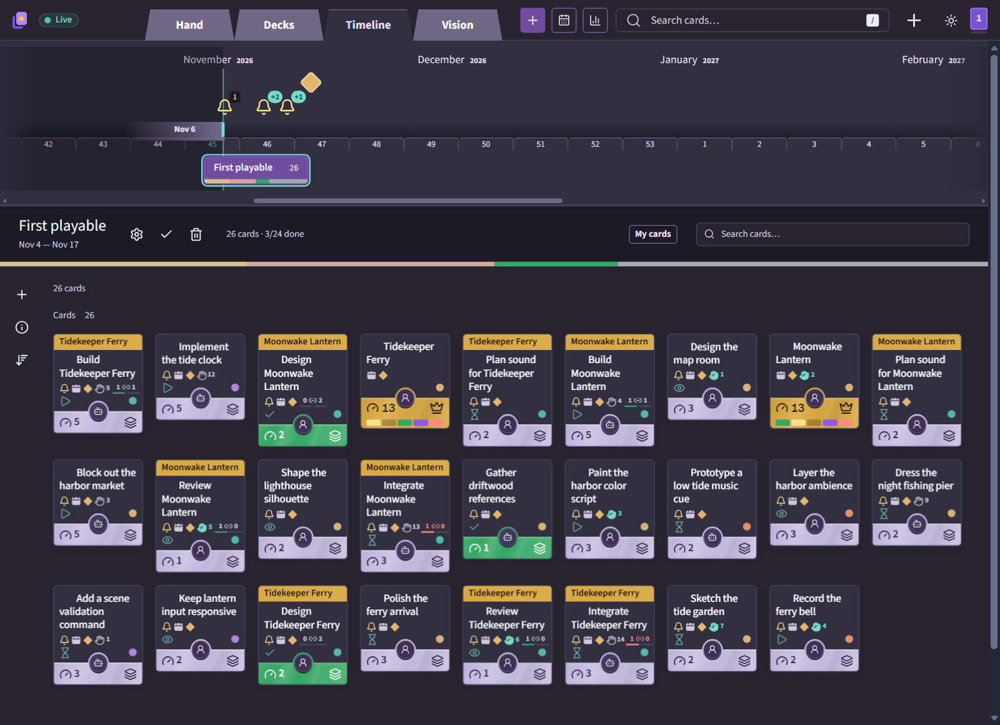
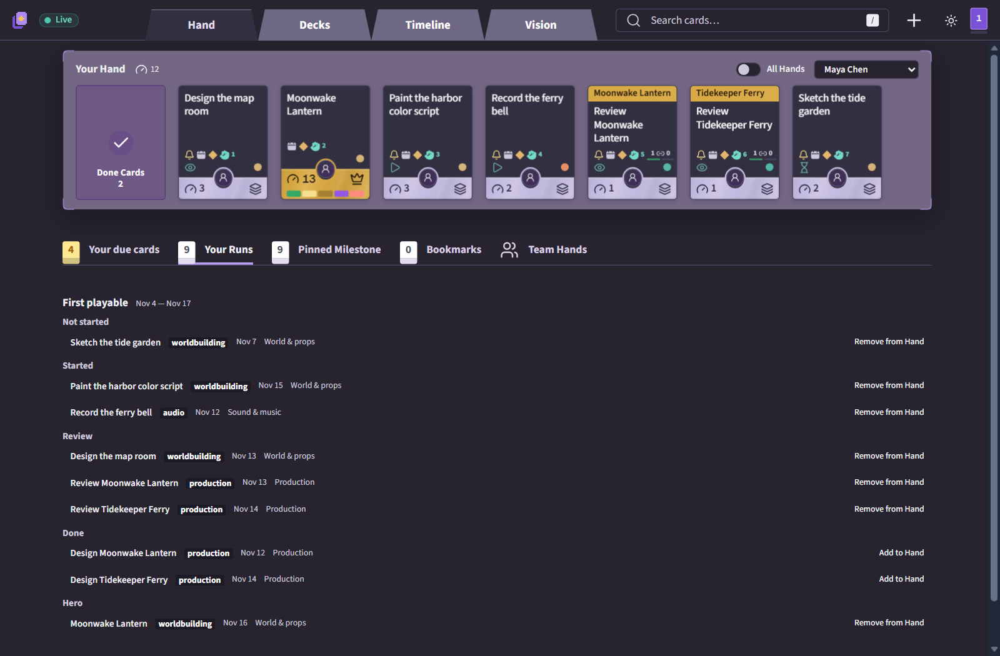
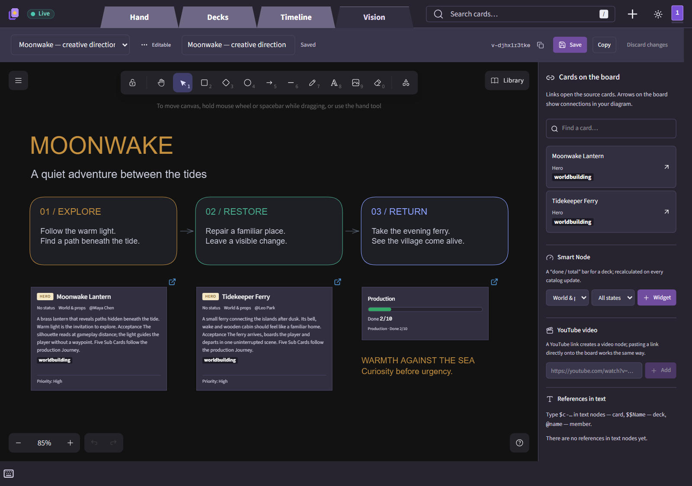

<div align="center">

<picture>
  <source media="(prefers-color-scheme: dark)" srcset="assets/logo/deckmate-256.png" />
  <source media="(prefers-color-scheme: light)" srcset="assets/logo/deckmate-256-light.png" />
  
</picture>

# Deckmate

### Все карты на руках.

Локальная доска проекта в Markdown для команд из людей и ИИ-агентов.

[](https://www.npmjs.com/package/deckmate)
[](LICENSE)
[](#попробовать-за-минуту)

[Попробовать](#попробовать-за-минуту) · [Свой проект](#со-своим-проектом) · [Понятия](#как-это-устроено) · [Агенты](#работа-с-ии-агентами) · [Вопросы](#вопросы)

[English](README.md) · **Русский**

</div>



Deckmate превращает папку с Markdown в доску проекта для команд, которые делают игры и софт: колоды, Hero-карты с Sub Cards, рука у каждого участника, Run и вехи на шкале времени, повторяемые Journey и полотно Vision. Каждая карта — обычный файл в вашем репозитории: люди правят её в приложении, ИИ-агенты читают и пишут тот же файл напрямую.

- **Доска живёт рядом с работой.** Всё хранится локально: карты — Markdown-файлы в вашем репозитории, полотна — файлы Excalidraw, историю хранит git. Поисковый индекс можно удалить и собрать заново.
- **Сразу видно, что требует внимания.** Пульс проекта показывает задачи в работе, очередь ревью, принятое за 14 дней, текущий Run и карты без колоды.
- **У людей и ИИ-агентов один процесс.** Агент берёт следующую карту из своей руки, читает только нужные правила, задаёт вопросы на карте и сдаёт отчёт на проверку.
- **Локально и бережно к файлам.** Без аккаунтов, облака, телеметрии и автокоммитов. Сохранение переписывает только изменённый блок; устаревшая запись отклоняется, а не затирает чужую работу.

## Попробовать за минуту

**Заходим с козырей.** Поставьте [Node.js](https://nodejs.org) 26 или новее, создайте демо-проект и откройте его:

```sh
npx deckmate init deckmate-demo
npx deckmate --data deckmate-demo
```

Доска откроется на `http://127.0.0.1:4317/`. Демо — маленькая вымышленная игровая студия: пять колод, два Hero с Sub Cards, люди и агенты, Journey, Run и доска Vision. Интерфейс по умолчанию английский, русский включается в меню приложения. Остановить сервер — `Ctrl+C`.

## Со своим проектом

**Существующая папка.** Запустите Deckmate из папки, которой хотите управлять; ваши Markdown-файлы остаются как есть, новые карты ложатся в `cards/`:

```sh
cd my-project
npx deckmate
```

**Новый проект.** Создайте пустую папку и откройте её: `mkdir my-game`, затем `npx deckmate --data my-game`. На вкладке Decks нажмите **Start from template** (или щёлкните логотип в левом верхнем углу → **Start from template…**; в русском интерфейсе — «Начать с шаблона…»). Заготовки есть и для игр, и для софта — полки «Игры» и «Софт»: десять игровых жанров — Action, Adventure, Platformer, Puzzle, Roguelike, RPG, Simulation, Sports, Strategy и Survival — и заготовки для пет-проектов, веб-приложений и библиотек. Заготовка создаёт колоды и Journey под такой проект, по желанию с примерами карт.

Правки сохраняются прямо в папку проекта. Историю ведите в git — сам Deckmate ничего не коммитит. Только посмотреть, ничего не меняя, — ключ `--read-only`.

| Ключ | Что делает |
|---|---|
| `--data <папка>` | Папка проекта; по умолчанию — текущая. |
| `--port <число>` | Порт, по умолчанию 4317. |
| `--read-only` | Запретить любую запись. |
| `--no-open` | Не открывать браузер. |

Те же настройки можно положить в `.env.local` в папке запуска — см. [.env.example](.env.example).

## Как это устроено

| Понятие | Что это |
|---|---|
| **Deck** (колода) | Набор карт одного вида — задачи, документы или ассеты; колоды группируются в пространства. |
| **Card** (карта) | Один Markdown-файл в `cards/`. У **Task** есть состояние, исполнитель, оценка (Effort) и приоритет; **Doc** хранит правила и справку. |
| **Hero** | Карта фичи. Её **Sub Cards** — задачи, из которых она собирается, и прогресс Hero считается по ним. |
| **Hand** (рука) | Очередь участника: семь слотов фокуса, упорядоченный резерв и сделанное за неделю. |
| **Run** и **Milestone** | Итерация с датами и цель с датой на шкале Timeline. Незаконченные карты переходят в следующий Run. |
| **Journey** | Повторяемый рецепт шагов, например концепт → модель → проверка. Применение создаёт Sub Cards, у каждой своя инструкция для человека или агента. |
| **Track** (трек) | Нить, связывающая карты разных колод, например релиз или область фичи. |
| **Vision** | Полотно Excalidraw с живыми ссылками на карты. |

Начните с **Decks**: из пульса проекта можно перейти к задачам в работе, ревью, текущему Run или картам без колоды. Компактные обложки показывают число карт и прогресс задач. Меняйте порядок колод мышью или клавиатурой; редко используемые колоды убирайте через настройки в **стопку** в конце пространства и возвращайте, когда понадобятся. Поиск по названиям найдёт колоду и внутри стопки.

Откройте колоду, чтобы работать с её картами, описанием, прогрессом и историей:



Все клавиши — по `?` в приложении: `N` создаёт карту, `/` — поиск, `Shift+1`–`Shift+4` переключают Hand, Decks, Timeline и Vision, а `O`, `E`, `P` или `,` над картой меняют исполнителя, Effort, приоритет или Run.

<table>
<tr>
<td width="50%" valign="top">
<a href="docs/screenshots/card.png"></a>
<strong>Карты и Journey</strong><br />Markdown с исполнителями, Effort, зависимостями и прогрессом Journey.
</td>
<td width="50%" valign="top">
<a href="docs/screenshots/timeline.png"></a>
<strong>Run и вехи</strong><br />Даты на шкале; незаконченные карты переходят в следующий Run.
</td>
</tr>
<tr>
<td width="50%" valign="top">
<a href="docs/screenshots/hand.png"></a>
<strong>Рука у каждого</strong><br />Слоты фокуса, резерв и сделанное — для людей и агентов.
</td>
<td width="50%" valign="top">
<a href="docs/screenshots/vision.png"></a>
<strong>Vision</strong><br />Наброски на полотне Excalidraw с живыми узлами карт и прогресса.
</td>
</tr>
</table>

## Работа с ИИ-агентами

Агент читает и правит те же файлы, что показывает доска. Карта выглядит так:

```markdown
---
deckmate: card
schema: 1
id: 3c83da5b-a6b4-4b29-9b20-0aace7b274ab
kind: task
title: Tune lantern glow
state: not-started
owner: null
deckId: null
trackIds: []
parentId: null
effort: 2
priority: medium
---
Make the path readable without revealing the whole forest.

- [ ] Check the light at gameplay distance.
- [ ] Ask a teammate to review the result.
```

Состояния — `not-started`, `discussing`, `in-iteration`, `started`, `review` и `done`. Колоды, участники и треки — в `tasks/deckmate.md`, Run и вехи — в `tasks/deckmate-runs.md` и `tasks/deckmate-milestones.md`, Journey — в `tasks/journeys/`, доски Vision — в `boards/`. У формата есть и русские слова (`план`, `в работе`, `принято`…): проект пишет на языке, записанном в его манифесте, а Deckmate читает оба.

Людей и агентов добавляют в меню логотипа → **Members…** («Участники…»); `<участник>` ниже — имя или ID оттуда. Команда `project` отдаёт агенту короткий JSON или Markdown без запущенного сервера (у `brief` JSON — по `--json`), чтобы он читал только нужное задаче:

```sh
npx deckmate project next <участник>       # следующая карта из руки участника
npx deckmate project brief <карта>         # карта, её правила и что читать дальше
npx deckmate project report <карта> --file report.md --member <участник> --state review
```

Назначение исполнителя никогда не запускает модель, а отчёт агента не принимает работу — это делает человек.

Вместе с Deckmate идёт скилл агента в открытом формате Agent Skills. Когда в проекте появилась первая колода или первый участник, `npx deckmate skills install` копирует его в проект для Claude Code и других агентов; дальше `/deckmate work <карта>`, `/deckmate plan`, `/deckmate review <карта>` и другие сценарии ведут модель по доске. Подробнее — [docs/skills.md](docs/skills.md), [контракт данных](docs/catalog.md) и [локальный API](docs/api.md).

## Вопросы

**Где мои данные?** В папке проекта: карты и инструкции в Markdown, манифест каталога и доски `.excalidraw`. Индекс SQLite лежит в папке кэша и собирается из файлов.

**Нужен ли интернет?** Только для установки. Доска работает локально на `127.0.0.1`; агенты читают файлы и при остановленном сервере.

**Можно работать командой?** Да, через git: каждый запускает Deckmate на своей копии, правки сливаются как любые файлы. Конфликтующее сохранение отклоняется, а не затирает чужое.

**А Docker?** Склонируйте репозиторий и в его папке соберите образ: `docker build -t deckmate .`. Затем откройте проект на просмотр из его папки: `docker run --rm -p 127.0.0.1:4318:4318 -e DECKMATE_READ_ONLY=1 -v "$PWD:/data:ro" deckmate` и зайдите на `http://127.0.0.1:4318/` (в PowerShell пишите `${PWD}`).

**Чем это отличается от облачной доски?** Доска — это файлы в вашем репозитории: без аккаунта и сервера, агенты читают её без API.

## Участие

Ждём сообщения об ошибках, идеи и pull request. [CONTRIBUTING.md](CONTRIBUTING.md) — запуск из исходников, тесты и правила проекта; [AGENTS.md](AGENTS.md) — короткая памятка для кодовых агентов. Соблюдайте [Code of Conduct](CODE_OF_CONDUCT.md); об уязвимостях пишите по [SECURITY.md](SECURITY.md), а не в открытые issue. Изменения — в [журнале изменений](CHANGELOG.md).

## Лицензия

[AGPL-3.0-only](LICENSE) © 2026 pierkulakov и участники Deckmate. Пользоваться, менять и распространять можно свободно; изменённую версию, запущенную как сетевой сервис, нужно открыть. Правки принимаются по [соглашению участника](CLA.md) (CLA).

## Благодарности

Модель работы Deckmate близко повторяет [Codecks](https://codecks.io) и приспособлена к Markdown-репозиториям и агентам. Vision построен на [Excalidraw](https://excalidraw.com); интерфейс — на [shadcn/ui](https://ui.shadcn.com) и Tailwind CSS. Лицензии шрифтов Source Sans 3, Roboto Mono, Geist и Assistant — в [assets/fonts](assets/fonts/).

Deckmate не связан с Codecks и не одобрен им. Бренд и снимки экрана — собственные.
